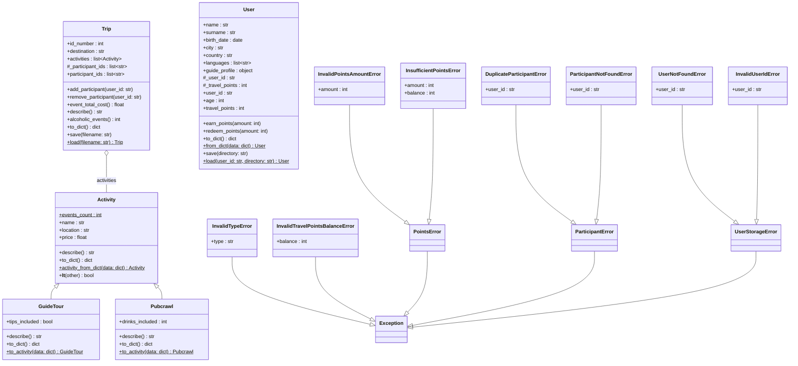

# Class Diagram
 
Current domain model of Travel&Go. GitHub renders the diagram below automatically.
 

 
## Notes
 
- **Inheritance:** `GuideTour` and `Pubcrawl` extend `Activity`.
- **Aggregation:** a `Trip` holds references to `Activity` objects that exist independently of it.
- **Trips and users:** a `Trip` stores only the IDs of its participants, never `User` objects. The link is therefore not drawn as an association, which avoids circular references and keeps `trip.py` independent of `user.py`.
- **Static and class members** are marked with `$`.
- **Read-only properties:** `User.user_id`, `User.age`, `User.travel_points` and `Trip.participant_ids` cannot be assigned. Points only change through `earn_points` and `redeem_points`, and `participant_ids` returns a copy.
- **Guide status:** `guide_profile` is `None` until the user becomes a guide.
- **Storage:** each user is saved in its own file, `data/users/<user_id>.json`. A user ID is checked before it is used as a file name.
- **Exceptions:** each family shares a base class, so related errors can be caught together (`PointsError`, `ParticipantError`, `UserStorageError`).
 
