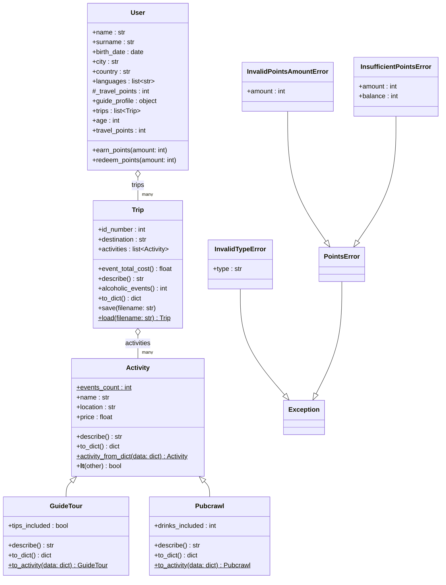

# Class Diagram

Current domain model of Travel&Go. GitHub renders the diagram below automatically.

## Notes

- **Inheritance:** `GuideTour` and `Pubcrawl` extend `Activity`.
- **Aggregation:** a `Trip` holds references to `Activity` objects that exist independently of it, and a `User` holds references to its `Trip` objects. Both relations are one-directional: `Trip` does not know its user, and `Activity` does not know its trip.
- **Static and class members** are marked with `$`.
- **Read-only properties:** `User.age` is computed from `birth_date`, and `User.travel_points` can only change through `earn_points` and `redeem_points`, which validate every amount.
- **Guide status:** `guide_profile` is `None` until the user becomes a guide.
- **Exceptions:** `InvalidTypeError` is raised when a saved activity has an unknown `type` field while loading from JSON. `InvalidPointsAmountError` and `InsufficientPointsError` share the base class `PointsError`, so both can be caught together.
