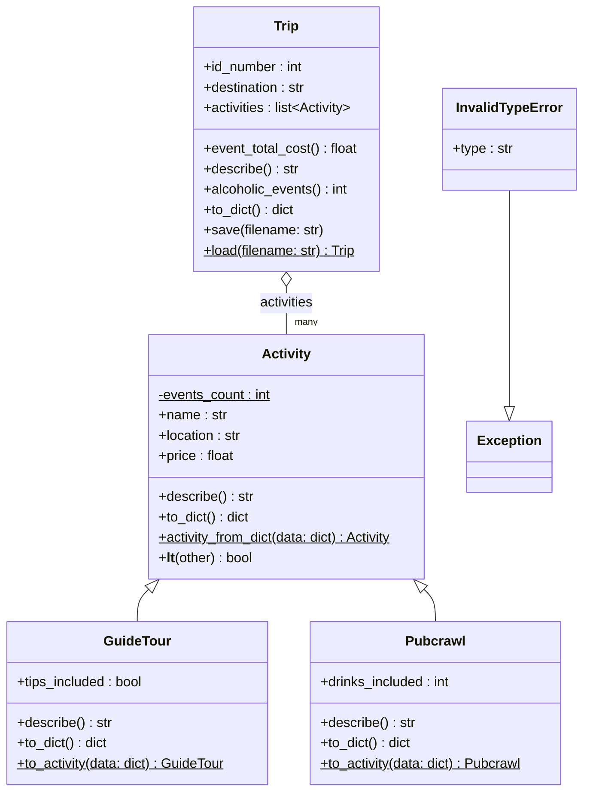

# Class Diagram

Current domain model of Travel&Go. GitHub renders the diagram below automatically.

## Notes

- **Inheritance:** `GuideTour` and `Pubcrawl` extend `Activity`.
- **Aggregation:** a `Trip` holds references to `Activity` objects that exist independently of it.
- **Static and class members** are marked with `$`.
- `InvalidTypeError` is raised when a saved activity has an unknown `type` field while loading from JSON.
